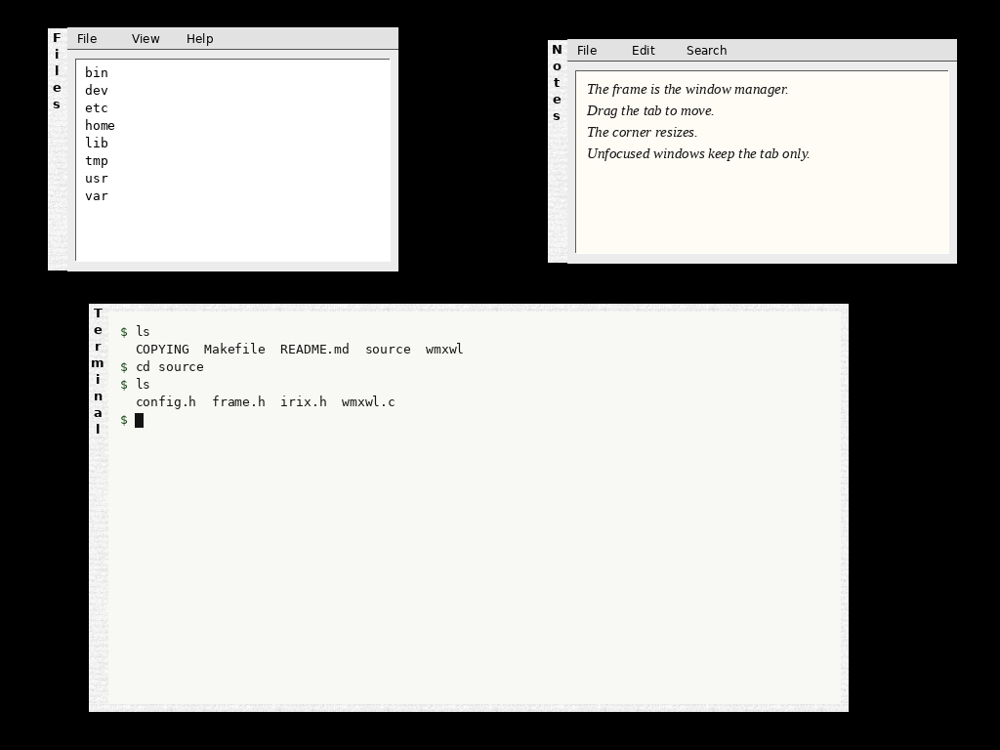
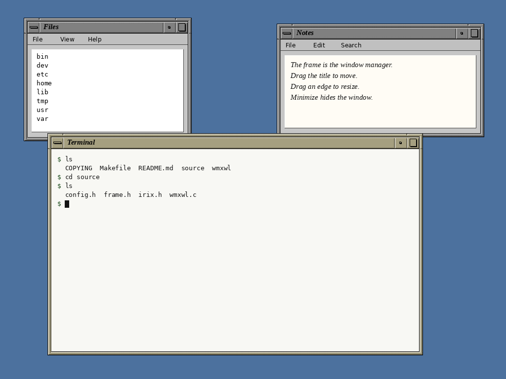

# wmxwl

A floating Wayland compositor in the style of [wmx](https://github.com/xaverh/wmx).
It is a small C program on top of [neuswc](https://git.sr.ht/~shrub900/neuswc),
starting from the [tohu](https://git.sr.ht/~shrub900/tohu) reference compositor.

Two frames, switched with Super+t. The wmx frame is the one at startup.

The wmx frame is `background.xpm` with a one-pixel black outline. An unfocused
window shows only the left tab. Focusing it adds the 8px frame on the other
three sides. neuswc cannot shape a window, so the tab is a full-height strip
rather than wmx's short tab with a diagonal cut, and the title is stacked
glyphs rather than letters rotated by Xft. The typeface is Bitstream Vera
Sans, 12px, demibold, black.



Sample of that frame, on the black root neuswc paints. The two upper windows
are unfocused, so only the tab is drawn. The lower one is focused. The titles
are stacked. DejaVu Sans Bold stands in for Bitstream Vera Sans here.

The other frame is the IRIX 4Dwm title bar (Indigo Magic). It is 32px on top
and 8px on the other sides, with the menu button, the minimize square and the
maximize square. A focused window is beige. An unfocused window is gray. The
title is Times, 14px, bold italic, black, along the top. The pixels were
measured from a screenshot of that frame. neuswc tiles them with the window,
so the stipple does not stay locked to the screen the way 4Dwm's does, and
the title is whatever Times your fontconfig provides, not the IRIX screen
font. The desktop stays black: neuswc has no call for a root colour, so the
IRIX blue (`#4c719e`) is not painted.



Sample of that frame. The blue behind it is the classic desktop colour, drawn
in the picture so the frame can be seen. wmxwl does not paint it.

## What it does

- Floating windows. Focus follows the pointer and does not raise.
- wmx frame: drag the tab to move. On a focused window, drag the bottom-right corner to resize.
- IRIX frame: drag the title to move. Drag an edge or a corner to resize. Minimize hides the window. Maximize toggles maximise. The menu button focuses the window and does nothing else; there is no window menu.
- Right-click the frame or the empty desktop to circulate. Middle-click the frame for the next channel. Middle-click the desktop for a launcher. The wheel on the frame changes channel.
- Channels 1–9, wrapping at either end. Hidden windows come back most-recently-hidden first, onto the current channel.
- Sticky windows, shown on every channel. There is no sticky glyph.
- Maximise, full height, and full width, inset by the frame. Switching themes recomputes that inset.

## What it does not do

- The shaped outline, the diagonal tab end, or rotated title text.
- The `~/.wmx` command menu and the client menu on the tab button. Middle-click on the desktop starts a launcher instead.
- The big green channel number. neuswc has no text overlay.
- An IRIX window menu, the IRIX screen font, or a screen-aligned stipple.
- Xwayland, unless you build neuswc with it. This Makefile does not link xcb.

Clicking a window's interior still raises it. That raise is inside neuswc, on the button path, and wmxwl does not do it for focus or for the frame.

## Build

Install neuswc and neuwld first, so `pkg-config` finds `swc` and `wld`.
Then:

```
make
sudo make install
```

From a free VT:

```
swc-launch wmxwl
```

`swc-launch` comes with neuswc and must be allowed to open the DRM device
(setuid root, or your seat-management setup).

## Keys

The modifier is Super, as in current wmx.

| Key | Action |
|-----|--------|
| Super+Up / Down | Raise / lower |
| Super+Tab / Super+Shift+Tab | Next / previous window |
| Super+Return | Hide |
| Super+Shift+Return | Unhide the last hidden window onto this channel |
| Super+BackSpace | Close |
| Super+Left / Right | Previous / next channel |
| Super+1 … 9 | Jump to a channel |
| Super+Shift+1 … 9 | Move the focused window to a channel |
| Super+Home | Toggle maximise |
| Super+End | Restore size |
| Super+Page Up / Page Down | Full height / restore height |
| Super+Keypad + / − | Full width / restore width |
| Super+Pause | Toggle sticky |
| Super+t | Switch between the wmx frame and the IRIX frame |
| Super+n | New terminal |
| Super+d | Launcher (`fuzzel`, `wmenu-run`, or `bemenu-run`) |
| Super+Shift+q | Quit |
| Super+Button1 | Move from anywhere |
| Super+Button3 | Resize from the bottom-right, from anywhere |

Change the starting theme, the tab width, the frame width, and the commands in [source/config.h](source/config.h). The IRIX font is `IRIX_FONT` in [source/irix.h](source/irix.h).

## Licence

ISC. See [COPYING](COPYING). tohu's copyright is uint's. The wmx frame texture
is from `background.xpm`, MIT, Chris Cannam and others. The IRIX frame is a
recreation of the 4Dwm title bar measured from a screenshot.
